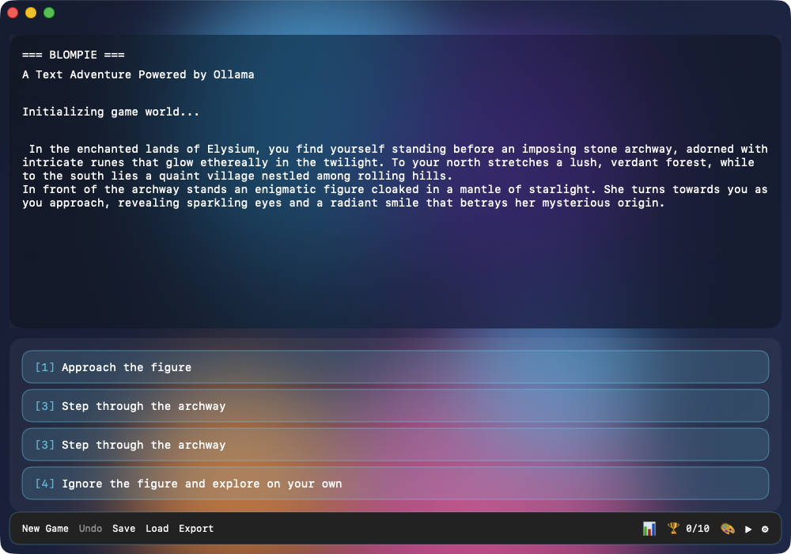
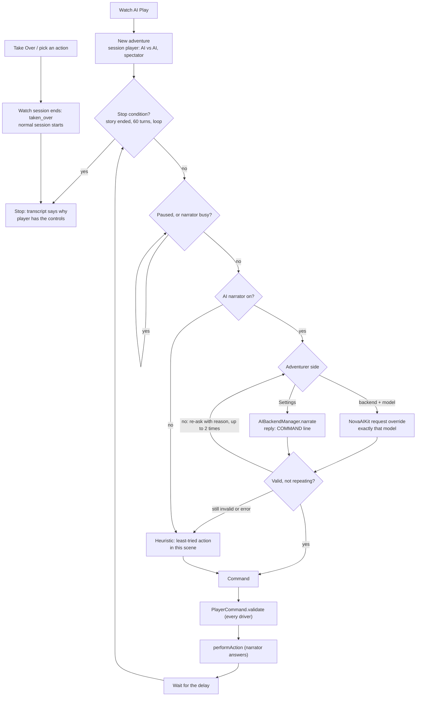
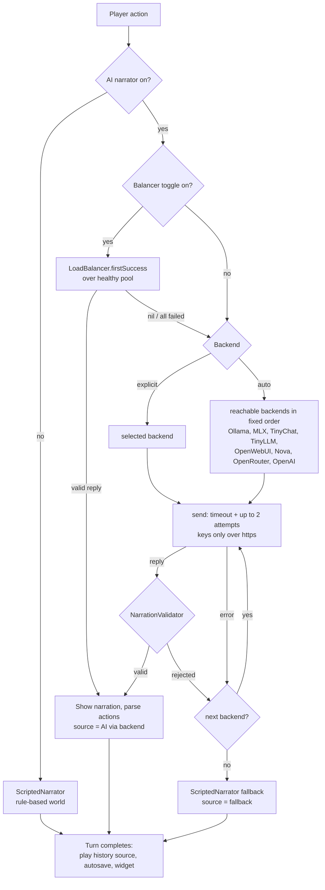
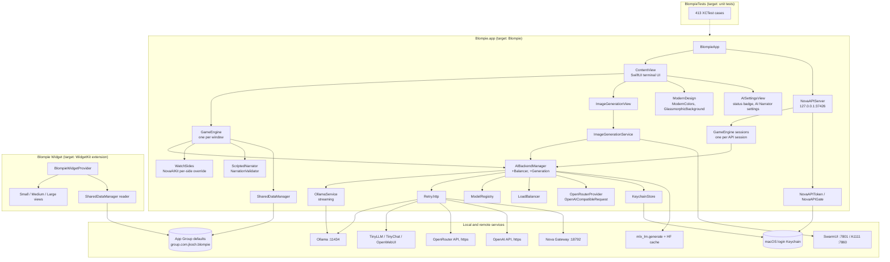
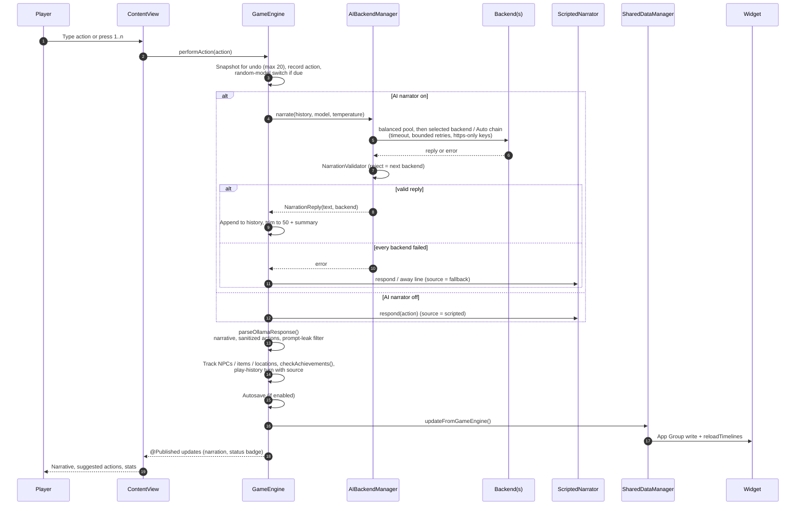
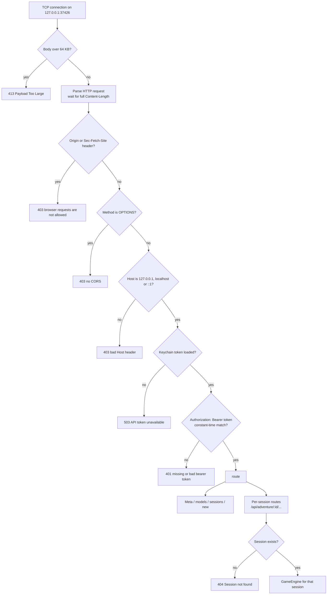

# Blompie


[](LICENSE)

-informational)


**An AI-powered text adventure for macOS. Every playthrough is generated on the fly.**

Blompie is a native SwiftUI text adventure in the spirit of Zork. A language model acts as the game master: it invents the world, the characters, the items and the consequences of whatever you type. By default it runs on your own Mac (Auto mode picks the first reachable of Ollama, MLX, TinyChat, TinyLLM, OpenWebUI, Nova Gateway, OpenRouter, OpenAI). You can optionally spread story generation across every local model you have (Ollama + MLX), frontier models through OpenRouter, and the Nova Gateway, with automatic failover between them.

The AI is optional. Switch it off, or let every backend go down, and a built-in scripted narrator keeps the game fully playable: a failed AI call never loses a turn. See [AI Options](#ai-options).

Blompie also exposes a token-protected loopback HTTP API so AI agents (Nova, Claude Code, scripts) can play adventures programmatically, and ships a WidgetKit widget that shows your current game at a glance.

Written by Jordan Koch ([@kochj23](https://github.com/kochj23)). Current version **1.5.0 (build 9)**; release history in [CHANGELOG.md](CHANGELOG.md).



---

<!-- watch-it-play:start -->
## Watch it play itself

AI versus AI, narrated by Nova (an AI voice). Two local models play each other; the narration is written from the game's own record of what happened.

| **Highlights:** [The door opened on turn 29. The price: a memory](https://www.youtube.com/watch?v=eF1JsnNwY8w) | **Full game:** [Two AIs played 60 turns of a text adventure](https://www.youtube.com/watch?v=4HcMhj7xWAU) |
|---|---|
| <a href="https://www.youtube.com/watch?v=eF1JsnNwY8w"></a> | <a href="https://www.youtube.com/watch?v=4HcMhj7xWAU"></a> |

<!-- watch-it-play:end -->

## Table of Contents

- [Features](#features)
- [AI Options](#ai-options)
- [Architecture](#architecture)
- [Data Flow](#data-flow)
- [Multi-Model Load Balancer](#multi-model-load-balancer)
- [Nova API (Local HTTP API)](#nova-api-local-http-api)
- [Security](#security)
- [Requirements](#requirements)
- [Installation](#installation)
- [Building from Source](#building-from-source)
- [Testing](#testing)
- [How to Play](#how-to-play)
- [Configuration Reference](#configuration-reference)
- [Repository Notes](#repository-notes)
- [License](#license)

---

## Features

### Gameplay (GameEngine)

| Feature | Details |
|---|---|
| Procedural adventures | A Zork-style game-master system prompt drives the model to create locations, NPCs, items, puzzles and plot turns. Combat is deliberately non-lethal; conflicts are puzzles, negotiations or escapes. |
| Scripted narrator | With AI off or unreachable, a deterministic rule-based world (Cinnamon Meadow, Bell Tower, Belfry, Upside-Down Market, Lopsided Library, Whispering Woods, Mirror Pond; items, characters Pim, Quillby, Fennick and Tansy) answers in the same format, so tracking and achievements keep working. |
| Story progression rules | The prompt requires every action to move the story forward (no re-describing the same scene). |
| Free-form input | Type any action in natural language, or click one of the 2-4 suggested actions. |
| Suggested actions | Parsed from the model reply in three accepted formats: `ACTIONS: a \| b \| c`, a numbered list (including `1. **Bold action**`), or a "What do you do?" style header followed by a list. If nothing parses, defaults are offered (Look around, Continue, Go back, Examine surroundings). |
| Prompt-leak filtering and output validation | Every model reply passes `NarrationValidator` before it touches game state: `<think>` blocks, chat-template tokens and control/bidi characters are stripped, replies with almost no letters or that echo the system prompt are rejected (the next backend or the scripted narrator answers instead), and narration is clipped at 6,000 characters. Suggested actions are trimmed, de-duplicated, capped at 80 characters and at most 6. Remaining prompt-echo lines are filtered from the narrative. |
| World tracking | NPC names, inventory items and visited locations are extracted heuristically from each reply and shown in the sidebar (Locations / Inventory / Characters tabs). |
| Achievements | 10 achievements persisted across sessions: First Steps, Explorer (5 locations), World Traveler (20), Social Butterfly (5 NPCs), Diplomat (15), Collector (5 items), Hoarder (15), Conversationalist (50 actions), Veteran Adventurer (200 actions), Trader (defined, not yet awarded by the engine). |
| Undo | Every action snapshots messages, conversation history and suggested actions. Up to 20 snapshots are retained (oldest dropped first). |
| Recent actions | The last 5 actions are shown under the transcript; the engine keeps the last 10. |
| Bounded context | Conversation history is capped at 50 non-system messages. Older turns are condensed into a single system summary message so long games keep their context without unbounded token growth. |
| Detail level | Brief (1-2 sentences), Normal (2-4) or Detailed (4-6). |
| Tone | Serious, Balanced or Whimsical. |
| Creativity | Temperature slider in Settings. |
| Random model mode | Optionally switch to a random installed Ollama model every 3, 5, 10 or 15 actions; the switch is announced in the transcript. |
| Watch AI Play (spectator mode) | Since 1.3.0: **Watch AI Play** starts a new adventure that an AI adventurer plays on its own. Since 1.5.0 the adventurer and the narrator can each run a different model (NovaAIKit). See [Spectator Mode](#spectator-mode-watch-ai-play). |
| Statistics | Total actions, NPCs met, items, locations, achievements, current model, last tokens/sec, save count, message count. |

### Spectator Mode (Watch AI Play)

Click **Watch AI Play** in the toolbar to sit back: a new adventure starts and an AI *adventurer* picks each command, the narrator answers, and the story plays out on its own.

| Part | Details |
|---|---|
| Adventurer | Asks for one `COMMAND:` line, given its personality, the recent story, the suggested actions and its own last commands. By default it uses the AI Narrator backend (`AIBackendManager`, any backend or Auto). |
| Model vs model | Since 1.5.0, Settings > **Watch AI Play: model vs model** gives the adventurer and the narrator each their own backend + model through [NovaAIKit](https://github.com/kochj23/NovaAIKit) 1.1.0's per-request override and model picker (local: Ollama, MLX, TinyLLM, TinyChat, OpenWebUI, Nova Gateway; cloud: OpenRouter, OpenAI, Anthropic, Google Gemini, xAI Grok, Mistral, DeepSeek, Meta). **Settings** (the default) keeps a side on the AI Narrator settings, so local models are used unless you pick a cloud one. Cloud keys are stored in the Keychain. An overridden side gets exactly that backend + model, with no failover. The **Allow Nova** switch keeps every request off the Nova Gateway. |
| Re-ask | An invalid or repeating command, or unusable narration from an overridden narrator, is re-asked up to 2 times with the reason. After that the built-in AI plays the turn (heuristic adventurer or scripted narrator) and `summary.fallbacks[side]` goes up. |
| Personality | Bundled `AdventurerPersonalities.json` (Balanced, Explorer, Collector, Chatterbox, Cautious): a style sentence for the model prompt, a category order for the heuristic and a temperature. A missing or broken file falls back to Balanced. |
| Fallback | When AI is off, the call fails, the reply is unusable or the AI keeps repeating itself, a heuristic picks the suggested action least tried in the current scene (take > talk > move > other > look), so it never stalls. In the scripted world it visits every place and collects every item. |
| Validation | One validator for every driver (`PlayerCommand.validate`: buttons, typed and API input, the AI adventurer, the heuristic): the `COMMAND:` line only, markdown and control/bidi characters stripped, needs a letter; 1-80 chars for the adventurer, 1-500 for the player. Each played command is recorded with its `driver` (`human`, `model`, `heuristic`). |
| SPECTATING bar | Red indicator, turn count, who chose the last command (AI via backend or heuristic), a delay slider (0.5-10 s between turns, default 3 s), **Pause/Resume** and **Take Over**. |
| Take over | **Take Over**, or clicking / pressing the number of any suggested action, stops the adventurer; you continue the same story. New Game or Load also stop it. |
| Stops on its own | When the narration says the story ended (`THE END` / game over), after 60 adventurer turns, or when the last 8 commands contain only 1-2 distinct ones (loop). A transcript line says why. |
| Recorded as AI vs AI | Since 1.4.0 (watch contract v2) a watch game is its own play session with `player` `AI vs AI` (never a human, excluded from human stats), `summary.spectator = true`, `summary.matchup` (sides `adventurer` and `narrator`: `kind` `model` with backend id, model and label, or `engine` for the heuristic / scripted narrator) and `summary.fallbacks` (`{"adventurer": n, "narrator": n}`). Events are recorded as usual, and Nova journals it as an "AI vs AI" entry. Outcome: `completed` (story ended), `turn_limit`, `stalled` (loop) or `taken_over`. Starting a watch closes your own open session as `completed`. Watching does not overwrite your autosave or unlock achievements. |
| The record | Since 1.5.0 every model reply in a watch game is a `model_reply` event (side, backend, model, a 120-char excerpt, `latency_ms`, `valid`, `attempt`, error), and every built-in AI turn is a `fallback` event. Journals and replays read these events and never call a model again. The summary also carries the adventurer `personality` and the gameplay `seed` (seeded SplitMix64 PRNG for gameplay randomness such as random model switching; cosmetic randomness stays separate). |
| Take over (recording) | The watch session ends as `taken_over` with everything so far, and a normal session (`player` `default`, `started_from` `takeover`) starts from that point. After a watch that stopped on its own, your next action starts a normal session (`started_from` `after_watch`). |



### Saving and Export

- Unlimited named save slots (Save dialog), plus an `autosave` slot written after every turn (AI or scripted) when auto-save is enabled.
- Load dialog lists slots newest first with date and message count; individual slots can be deleted, or all saves at once from Settings.
- The autosave is restored automatically on launch; if none exists a new game starts.
- Export the full transcript as a plain-text file via a save panel.
- Game state, saves, settings and achievements are stored in `UserDefaults` (settings as one consolidated JSON bundle, with one-time migration from the older per-key format).

### Play History (Nova Games DB)

Since 1.1.2 Blompie records what you played in the shared play-history schema `play` of the Nova Games Postgres on core3, so Nova can write about your adventures. Only play rows are written; saves stay in `UserDefaults`.

| When | What is written |
|---|---|
| New adventure, or loading any save (including the autosave at launch), Watch AI Play (`player` `AI vs AI`, see Spectator Mode), or a take-over | A new `play.sessions` row (`game` `blompie-mac`, `client` `mac`, `player` `default`) and a `start` event (`setting` or `slot`/`resumed`, model, tone, detail). The previously open session ends with outcome `completed`. |
| Opening narration | A `scene` event with a narrator excerpt (max 400 chars). |
| Every turn | A `turn` event: turn number, your action (max 200 chars), narrator excerpt (max 400 chars), achievements unlocked that turn, and `source` (`llm`, `fallback` when the AI was unreachable and the scripted narrator answered, or `scripted` when AI is off). Since 1.2.0 a turn never fails: a fallback turn is recorded as a normal turn. The session's `last_seen_at`, `actions` and running `summary` (now with a `fallbacks` count) are updated. The `start` event also records `ai_enabled`. |
| App quit | The session ends with outcome `quit` (best effort, up to 2 s). |

The session `summary` holds: turns, started_from, slot, model, tone, detail, achievements unlocked this session and total, places / items / NPCs (last 40 each, plus counts), the last scene and the last 30 turns as `moments`. Blompie has no win condition, so there is no `game_over` event and no score.

Logging never blocks a turn: rows go into a small in-memory queue (max 500, oldest events dropped first) drained in the background. If the DB is unreachable the queue is retried with backoff (5 s doubling to 5 min); rows the DB rejects are dropped. Under XCTest the logger has no DB connection. NovaAPIServer sessions are not logged.

Connection: `192.168.1.5:5433`, database `games`, LAN role `blompie_mac` (insert/update/select of its own `play` rows only), SCRAM over TLS 1.2+ with `verify-full` against the bundled games-pg CA (`Blompie/Storage/games-pg-ca.crt`, server name `nova-core3`). The password lives only in Blompie's Data Protection keychain (service `nova-games-pg`, account `blompie_mac`). On first launch, if it is missing, Blompie fetches it once with `ssh -o BatchMode=yes kochj@192.168.1.5 sudo bash /srv/games/repo/deploy/remote.sh getpw blompie_mac` (stdout straight into the Keychain, never printed). **Settings > Play History** shows the status and has a "Fetch DB password from core3" button to repeat the hand-off.

### Interface (ContentView, Design/ModernDesign)

- Glassmorphic UI: animated gradient background with floating blobs, glass cards, monospaced type.
- Narrator status badge in the toolbar: "Narrator online: Ollama" / "Narrator away" / "AI off: scripted narrator", plus who narrated the last turn (AI via backend, or scripted).
- Live streaming display: tokens appear as Ollama generates them (or instant mode when streaming is off; other backends reply in one piece).
- Tokens-per-second readout from Ollama's `eval_count` / `eval_duration`.
- Number keys `1`-`n` trigger the matching suggested action.
- Font size 8-36 pt via slider or `Ctrl+Shift+=` / `Ctrl+Shift+-`.
- Toolbar: New Game, Undo, Save, Load, Export, Watch AI Play, Stats, Achievements, Image Generation, Sidebar, Settings.
- Five color themes (Classic Green, Amber Terminal, Retro Blue, Paper Mode, Matrix Green). The selection is persisted; Paper Mode switches the window to light appearance.

### AI-Generated Artwork (ImageGenerationService / ImageGenerationView)

- Generate a Scene Illustration, Character Portrait or Item/Object image from the latest narrative, or use a custom prompt.
- Six styles that append style keywords to the prompt: Realistic, Artistic, Fantasy, Pixel Art, Cartoon, Anime.
- Backend priority: SwarmUI (`:7801`, Flux schnell) then Automatic1111 (`:7860`). (ComfyUI was removed in 1.2.0; it was detected but never implemented.)
- Save the result to the Desktop as PNG or copy it to the clipboard; recent images are kept for the session.

### macOS Widget (Blompie Widget target)

| Size | Shows |
|---|---|
| Small | Adventure name, action count, achievement count |
| Medium | Adventure name, last action, action count, achievement progress |
| Large | Current adventure, achievement progress, AI narrator status (backend that answered last, or Scripted) and model |

- Data is shared through the App Group `group.com.jkoch.blompie` (`SharedDataManager`), written after every AI reply and whenever an achievement unlocks, followed by a `WidgetCenter` timeline reload.
- The timeline also refreshes every 15 minutes. A configuration intent toggles "Show AI Status".

---

## AI Options

Everything here is in **Settings > AI Narrator** (plus **Multi-Model Load Balancing** for the pool toggles and the OpenRouter key).

| Option | What it does |
|---|---|
| Use AI narrator (global toggle) | On (default): a model narrates. Off: the built-in scripted narrator runs the game and nothing is sent over the network (no generation, no probes). |
| Backend picker | `auto`, `ollama`, `mlx`, `tinyllm`, `tinychat`, `openwebui`, `novagateway`, `openrouter`, `openai` (the shared `LLMBackendType` ids; the lowercase id is what is persisted). Claude is reached through `novagateway` or OpenRouter (`anthropic/claude-*`). |
| Auto | Tries every reachable backend in a fixed order: Ollama, MLX, TinyChat, TinyLLM, OpenWebUI, Nova Gateway, OpenRouter, OpenAI. Availability is re-probed when older than 30 s; a backend that fails is marked unreachable and the next one is tried. |
| Model picker | Ollama / TinyChat / OpenWebUI use the model list from Ollama `/api/tags`; OpenRouter has its own model list; OpenAI, MLX and TinyLLM take a model name; Nova Gateway is always `nova`. |
| Endpoints | Every URL is editable (Ollama, TinyLLM, TinyChat, OpenWebUI, Nova Gateway, OpenRouter, OpenAI). Defaults point at this Mac; any LAN host works. Invalid URLs are flagged and not saved. |
| API keys | OpenAI and OpenRouter keys are entered in `SecureField`s and stored only in the Keychain: OpenAI under service `com.jordankoch.Blompie` (account `AIBackend_OpenAI_Key`), OpenRouter under Blompie's own service `com.jordankoch.Blompie.openrouter`. Keys are never written to `UserDefaults` or the environment. |
| https only | A request that carries an API key is refused unless the URL is `https://` (`LLMError.insecureEndpoint`), so a key can never go out over plain http. Cloud backends count as available only with a key and an https URL. |
| Status + Test connection | The toolbar badge shows the active backend and whether it is reachable; Settings lists every backend's status and has a **Test connection** button (live probe of the selected backend, or of the whole Auto chain). |
| Timeouts and retries | Local requests time out after 180 s (first load of a big model), cloud requests after 60 s, probes after 3 s. Each backend gets at most 2 attempts (retry only on 408/429/5xx/transport errors, 0.5 s backoff, via `Retry.http`, copied from GTNW) before failing over. |
| Scripted fallback | If no backend produces a valid reply, the turn still completes. At the start of a game the scripted narrator opens a small rule-based world (seven places, items, three characters) and keeps running it; mid-story it shows a short "narrator away" line and keeps your current actions so you can try again. Scripted text is shown but never fed back to the model. The transcript marks fallback turns. |
| Output validation | See "Prompt-leak filtering and output validation" above. A rejected reply counts as a failed backend. |



Removed in 1.2.0: the Google Cloud, Microsoft Azure, AWS and IBM Watson backends (they always threw and never worked; OpenRouter covers frontier models with one key), the never-compiled `EthicalAIGuardian` / `AIBackendManager+Enhanced` / `+EthicalGuardian` / `AIBackendStatusMenu`, the unused `AIBackendSelectionView` and the unused `Blompie/AICapabilities/*` module (which read `OPENAI_API_KEY` from the environment).

Upgrading from 1.1.x: the backend saved as a display name (for example `MLX Toolkit`) is mapped to its id; a removed cloud backend becomes Auto. The OpenRouter key Blompie used to share with AIStudio (`com.jkoch.aistudio.openrouter`) is read once, copied to `com.jordankoch.Blompie.openrouter`, and the AIStudio item is left untouched. Any old cloud keys still in `UserDefaults` are moved (OpenAI) or deleted (the removed backends).

---

## Architecture



### Source map

| Path | Purpose |
|---|---|
| `Blompie/BlompieApp.swift` | App entry point; starts the Nova API server; font-size menu commands |
| `Blompie/GameEngine.swift` | Game state, system prompt, response parsing, world tracking, achievements, undo, save/load, export, settings; asks the narrator, falls back to the scripted narrator; spectator loop (Watch AI Play) |
| `Blompie/Narration.swift` | `NarrationSource` (llm / fallback / scripted / per-side model), `NarrationValidator` (output checks), `ScriptedNarrator` (rule-based world), `Adventurer` (spectator prompt, heuristic pick, loop/end detection), `PlayerCommand` + `CommandDriver` (one validator for every driver), `AdventurerPersonality`, `SplitMix64` |
| `Blompie/Services/WatchSides.swift` | Model vs model: `BlompieAI` (the app's NovaAIKit instance), `WatchSide` (backend + model per side), `SideAI` (per-request override) |
| `Blompie/AdventurerPersonalities.json` | Adventurer personality table |
| `Blompie/AISettingsView.swift` | Toolbar narrator status badge; SPECTATING bar; Settings > AI Narrator (toggle, backend/model pickers, endpoints, keys, status, Test connection, Allow Nova); Settings > Watch AI Play: model vs model (NovaAIKit pickers per side, personality) |
| `Blompie/ContentView.swift` | Main window, sidebar, save/load/settings/stats/achievements sheets |
| `Blompie/OllamaService.swift` | Ollama `/api/tags` and `/api/chat` (streaming + non-streaming), tokens/sec |
| `Blompie/NovaAPIServer.swift` | Loopback HTTP API, Keychain token, request gate |
| `Blompie/ImageGenerationService.swift`, `ImageGenerationView.swift` | Artwork generation |
| `Blompie/ColorTheme.swift` | Theme definitions and `CodableColor` |
| `Blompie/TokenMeterView.swift` | Circular tokens/sec gauge component |
| `Blompie/SharedDataManager.swift` | Writes widget data to the App Group |
| `Blompie/Storage/PlayLogger.swift` | Play-history sessions/events queue, backoff, Keychain credentials, SSH password hand-off |
| `Blompie/Storage/PostgresPlaySink.swift` | PostgresNIO writer for `play.sessions` / `play.events` (TLS verify-full) |
| `Blompie/Design/ModernDesign.swift` | Shared palette, glass modifiers, animated background, gauges |
| `Blompie/Services/ModelRegistry.swift` | Model discovery, pool assembly, `LoadBalancer` |
| `Blompie/Services/OpenRouterProvider.swift` | OpenRouter constants, OpenAI-compatible request builder, `FailoverPlanner` |
| `Blompie/Services/KeychainStore.swift` | Generic-password Keychain wrapper |
| `Blompie/Services/LLMBackendType.swift` | Canonical backend ids shared by every game, Auto order, legacy-value migration |
| `Blompie/Services/LLMLoadBalancerSupport.swift` | `ChatMessage`, `LLMError` |
| `Blompie/Services/Retry.swift` | `RetryPolicy`, `Retry.http`, injectable `HTTPTransport` (copied from GTNW) |
| `AIBackendManager.swift` | AI toggle, backend selection, endpoints, models, Keychain keys and migration, availability probes, status, persistence |
| `AIBackendManager+Balancer.swift` | OpenRouter key and model list, pool discovery, health gating, balanced dispatch |
| `AIBackendManager+Generation.swift` | `narrate` (balancer, then selected backend or Auto chain, validation), `send` for every backend, request/response helpers |
| `Blompie Widget/*` | Widget provider, views, data model, App Group reader |

---

## Data Flow

### Player action to screen and widget



### Nova API request



---

## Multi-Model Load Balancer

Settings > **Multi-Model Load Balancing** has three independent toggles. With all three off (the default), Blompie uses the backend chosen in Settings > AI Narrator (Auto by default).

| Toggle | Adds to the pool |
|---|---|
| Balance across all local models (Ollama + MLX) | Every model from Ollama `/api/tags`, plus every `*mlx*` repo in `~/.cache/huggingface/hub` |
| Enable all frontier models (OpenRouter) | Every model id from OpenRouter `/models` (falls back to a built-in popular list if the fetch fails). Requires an OpenRouter API key, entered in Settings and stored in the Keychain (service `com.jordankoch.Blompie.openrouter`). Requests carry `HTTP-Referer: https://github.com/kochj23/Blompie` and `X-Title: Blompie`. |
| Use Nova Gateway (optional) | One entry, `nova`, at `http://127.0.0.1:18792/v1/chat/completions` |

How a request is dispatched:

1. **Pool assembly** (`ModelRegistry.assemblePool`): concatenates the enabled sources and de-duplicates by `backend|model` id, preserving order. Unreachable sources contribute zero models; discovery never throws.
2. **Health gating**: each distinct backend is probed once with a 3 s timeout (Ollama `/api/tags`, MLX binary present, OpenRouter `/models` with the key over https, Nova `/v1/models`). Models on unhealthy backends are skipped. Nova is never required; a failed health check simply drops it.
3. **Selection policy** (`BalancerPolicy`): `roundRobin` cycles through healthy models; `leastBusy` (the default) picks the model with the fewest in-flight requests, ties broken by pool order.
4. **Failover** (`LoadBalancer.firstSuccess`): tries each healthy model in policy order (each request itself gets the bounded `Retry.http` attempts). A model whose request throws, or whose reply fails `NarrationValidator`, is dropped and the next is tried. Every attempt is checked out and back in, so in-flight counts stay accurate on failure. It returns the first success, returns `nil` when no model is healthy, and rethrows the last error only when every healthy model failed.
5. **Fallback**: if balancing is off, the pool is empty, nothing is healthy, or every model failed, `narrate` continues with the AI Narrator backend (or the Auto chain); if that fails too, the scripted narrator answers.

The balanced path is non-streaming (the reply appears when complete); Ollama streams when it is reached through the AI Narrator backend and streaming is on.

`Blompie/Services/*` (`LLMBackendType`, `ModelRegistry` + `LoadBalancer`, `OpenRouterProvider` + `FailoverPlanner` + `EndpointPolicy`, `KeychainStore`, `LLMLoadBalancerSupport`, `Retry`) is the canonical copy of the balancer for every other game. Covered by `LoadBalancerTests` (20), `RetryTests` (9), `AIParityRetryTests` (8) and `PerformanceTests`.

---

## Nova API (Local HTTP API)

`NovaAPIServer` listens on **127.0.0.1:37426** only (never on external interfaces). It lets agents create and drive adventure sessions; each session owns its own `GameEngine`, independent of the window.

### Authentication

Every route, including `/api/ping`, requires:

```
Authorization: Bearer <token>
```

On first launch Blompie generates a random 256-bit token (64 hex characters) with `SecRandomCopyBytes` and stores it in the login Keychain:

- service: `net.digitalnoise.blompie.api`
- account: `api-token`

If the Keychain is unavailable the API stays off. Read the token at call time; never paste it into scripts or files:

```bash
TOKEN=$(security find-generic-password -s net.digitalnoise.blompie.api -a api-token -w)

curl -s -H "Authorization: Bearer $TOKEN" http://127.0.0.1:37426/api/status

SID=$(curl -s -X POST -H "Authorization: Bearer $TOKEN" -H "Content-Type: application/json" \
  -d '{"model":"mistral:latest","tone":"whimsical","detail":"brief"}' \
  http://127.0.0.1:37426/api/adventure/new | python3 -c 'import sys,json;print(json.load(sys.stdin)["sessionId"])')

curl -s -X POST -H "Authorization: Bearer $TOKEN" -H "Content-Type: application/json" \
  -d '{"command":"look around"}' \
  http://127.0.0.1:37426/api/adventure/$SID/action
```

### Request gate (`NovaAPIGate`)

| Check | Result on failure |
|---|---|
| Request larger than 64 KB (65,536 bytes) | 413 |
| Any `Origin` or `Sec-Fetch-Site` header (browser) | 403 |
| `OPTIONS` (CORS preflight) | 403 |
| `Host` not `127.0.0.1`, `localhost` or `::1` (DNS-rebinding defense; port ignored) | 403 |
| No token in Keychain | 503 |
| Missing or wrong bearer token (constant-time comparison) | 401 |
| `command` empty or over 500 characters (action route) | 400 |

Responses never include CORS headers and always carry `X-Content-Type-Options: nosniff`, `Cache-Control: no-store` and `Connection: close`.

### Routes

| Method | Path | Body | Returns |
|---|---|---|---|
| GET | `/api/status` | | status, app, version, port, uptimeSeconds, activeSessions |
| GET | `/api/ping` | | `{"pong":"true"}` |
| GET | `/api/models` | | Installed Ollama models (from the configured Ollama URL's `/api/tags`; empty when AI is off) and a recommended model |
| GET | `/api/adventure/sessions` | | Array of sessions: sessionId, model, messageCount, inventory, isLoading |
| POST | `/api/adventure/new` | optional `model` (default `qwen2.5:72b`), `tone` (`serious`/`balanced`/`whimsical`), `detail` (`brief`/`normal`/`detailed`) | 201 with sessionId, settings, initialMessages, suggestedActions |
| GET | `/api/adventure/:id` or `/api/adventure/:id/state` | | isLoading, messageCount, last 10 messages, suggestedActions, inventory, locations, npcs, actionCount |
| GET | `/api/adventure/:id/history` | | All messages, actionHistory, inventory, locations, npcs |
| POST | `/api/adventure/:id/action` | `{"command": "..."}` (1-500 chars) | Waits up to 120 s for the reply; returns new messages, suggestedActions, inventory, `timedOut`. 429 if the session is still generating. |
| POST | `/api/adventure/:id/save` | optional `slotName` (default `nova-<first 8 of id>`) | `{"saved":true,"slotName":...}` |
| GET | `/api/adventure/:id/saves` | | Array of save slots: id, name, messageCount, savedDate (ISO 8601) |
| POST | `/api/adventure/:id/undo` | | undone, messageCount, last 5 messages |
| DELETE | `/api/adventure/:id` | | `{"deleted":true,"sessionId":...}` |

Unknown routes return 404; unknown session ids return 404 `Session not found`. Sessions live in memory and are lost when the app quits; saves go to the same store as the app's save slots.

---

## Security

- **Secrets live only in the macOS Keychain.** The Nova API token (`net.digitalnoise.blompie.api` / `api-token`), the OpenRouter key (`com.jordankoch.Blompie.openrouter`, Blompie's own item; the old AIStudio-shared item is read once and left untouched) and the OpenAI key (`com.jordankoch.Blompie` / `AIBackend_OpenAI_Key`) are never written to `UserDefaults`, the environment, files or the repository. Clearing a key field deletes the item instead of storing an empty one.
- **API keys only over https.** Any request carrying a key to a non-https URL is refused before it is sent. Local backends never receive a key.
- **AI output is validated** before it reaches game state (see [AI Options](#ai-options)).
- **No secrets in the repo.** Nothing is hardcoded; the `SourceCodeSecurityTests` suite scans the sources for hardcoded keys and passwords.
- **Local API hardened** as described above: loopback bind, bearer token on every route, browser and preflight refusal, Host allow-list against DNS rebinding, constant-time token compare, request and command size limits, no CORS.
- **Local by default.** Endpoints default to this Mac. Cloud backends (OpenRouter, OpenAI) are used only when you select them or Auto reaches them, and only with a key you supplied. With the AI narrator switched off, Blompie makes no AI network calls at all.
- **No telemetry.** Blompie has no analytics or phone-home code. Play history goes only to Jordan's own LAN Games DB (see [Play History](#play-history-nova-games-db)) as the restricted role `blompie_mac`, over verified TLS, with the password in the Data Protection keychain.
- **Entitlements.** Network client access, the `group.com.jkoch.blompie` App Group, and a `keychain-access-groups` entry for the Games DB credential. The app is not sandboxed (it needs to launch `mlx_lm.generate` and read the Hugging Face cache).

See [SECURITY.md](SECURITY.md) for reporting vulnerabilities.

---

## Requirements

| Requirement | Version |
|---|---|
| macOS | 14.0 (Sonoma) or later |
| Xcode | 15 or later (to build from source) |
| AI (optional) | Any one of: Ollama (default `localhost:11434`, at least one model pulled, default `mistral`), `mlx-lm` (`/opt/homebrew/bin/mlx_lm.generate`), TinyLLM, TinyChat, OpenWebUI, Nova Gateway (`127.0.0.1:18792`), an OpenRouter key or an OpenAI key. With none of them, the scripted narrator runs the game. |
| Optional | SwarmUI or Automatic1111 for artwork |

Apple Silicon with 16 GB RAM is recommended for larger local models.

---

## Installation

### From DMG

1. Download `Blompie-v1.5.0-build9.dmg` (current version **1.5.0, build 9**) from [Releases](https://github.com/kochj23/Blompie/releases).
2. Open the DMG and drag **Blompie** onto the `Applications` shortcut.
3. Optional, for the AI narrator: start any supported backend, for example Ollama:

```bash
brew install ollama
ollama serve
ollama pull mistral
```

   Or point Settings > AI Narrator at an MLX / TinyLLM / TinyChat / OpenWebUI / Nova Gateway URL, or add an OpenRouter or OpenAI key. With no backend at all, the scripted narrator runs the game.

4. Launch Blompie. It restores your autosave, or starts a new adventure. The toolbar badge shows whether the narrator is online.

---

## Building from Source

```bash
git clone git@github.com:kochj23/Blompie.git
cd Blompie

# Release build
xcodebuild -project Blompie.xcodeproj -scheme Blompie -configuration Release build

# Archive
xcodebuild -project Blompie.xcodeproj -scheme Blompie -configuration Release \
  -archivePath build/Blompie.xcarchive archive
```

Or open `Blompie.xcodeproj` in Xcode and press Cmd+R. The scheme builds the app and embeds the widget extension.

---

## Testing

```bash
xcodebuild -project Blompie.xcodeproj -scheme Blompie test
```

The suite contains **413 XCTest cases, all passing**, in 7 categories. Network-dependent logic is tested without live backends: pure functions for pool parsing, balancing and failover, and an injected `HTTPTransport` stub plus a stub narrator for the AI layer (`AIParityTests.swift`).

| Category | Classes (test count) | Total | Covers |
|---|---|---|---|
| Security | SourceCodeSecurityTests (8), NovaAPIGateTests (10), InputSanitizationTests (3), AIOutputValidationSecurityTests (6), ComprehensiveSecurityTests (9), PlayLoggerSecurityTests (8), AIParitySecurityTests (10), SpectatorSecurityTests (3), ModelVsModelSecurityTests (4), IdLearningsSecurityTests (3) | 64 | No hardcoded secrets, API gate (browser/Host/token/size), input limits, Keychain round-trip and UserDefaults migration, keys never over http, local backends never get a key, OpenRouter attribution, one-time AIStudio key migration, AI off sends nothing, output validation (think blocks, template tokens, prompt echo, control chars); play logging security; spectator command sanitizing, bounded prompt, watch game recorded as `AI vs AI` with `summary.spectator`, never as the human; model vs model: Allow Nova off keeps Nova out of every path (even when picked explicitly), the kit instance is isolated under XCTest, `model_reply` events are bounded; one validator for every driver, junk commands never start a turn, hostile personality tables filtered |
| Performance | PerformanceTests (8), PlayLoggerPerformanceTests (2), AIParityPerformanceTests (5), SpectatorPerformanceTests (1), ModelVsModelPerformanceTests (1) | 17 | Gate throughput, constant-time compare, tag/model parsing, pool de-dup, balancer selection, validator and scripted-narrator throughput, fail-fast when nothing is reachable; recording model replies is cheap |
| Retry | RetryTests (9), PlayLoggerRetryTests (6), AIParityRetryTests (8), SpectatorRetryTests (2), ModelVsModelRetryTests (3) | 28 | `LoadBalancer.firstSuccess` failover; 503 retried, 4xx not retried, retries bounded, Auto fails over in the fixed order, invalid output fails over, explicit backend does not fail over, timeouts applied, balancer failure falls through to the chain; play-log backoff; failed or invalid AI adventurer falls back to the heuristic; an invalid model command is re-asked, three invalid ones fall back to the heuristic and are counted; invalid narration is re-asked, then the scripted narrator answers |
| Unit | ComprehensiveUnitTests (30), AIBackendEnumTests (6), AIErrorTests (6), ImageStyleTests (3), ImageGenerationErrorTests (6), GameModelTests (14), ColorThemeTests (16), OllamaServiceTests (17), LoadBalancerTests (20), WidgetDataTests (9), AIBackendManagerTests (5), PlayLoggerUnitTests (10), AIParityUnitTests (10), SpectatorUnitTests (5), ModelVsModelUnitTests (3), IdLearningsUnitTests (4) | 164 | Models, enums (incl. legacy backend-value migration), errors, themes, Ollama contracts, registry and balancer, endpoints and model names per backend, request/response helpers, URL policy, status text, widget data, play-log JSON; watch side defaults and round trip, re-ask limit 2, model source labels; SplitMix64 reference vector, bundled personalities and fallback, personality drives heuristic and prompt |
| Integration | ComprehensiveIntegrationTests (9), NovaAPIServerTests (7), PlayLoggerIntegrationTests (3), AIParityIntegrationTests (4), SpectatorIntegrationTests (3), ModelVsModelIntegrationTests (1), IdLearningsIntegrationTests (2) | 29 | Component wiring, API server, GameEngine + narrator + stub transport end to end (configured Ollama URL and model), play history `source` for llm / fallback / scripted turns; AI adventurer command reaches the narrator; the player's session is closed and gets no watch events; watch summary matchup and fallbacks; take-over ends the watch as `taken_over` and starts a human session; each side uses its own backend + model and every reply is recorded; the record carries seed, driver, personality and fallbacks; human turns tagged `human` |
| Functional | ComprehensiveFunctionalTests (14), GameEngineTests (12), ResponseParsingTests (26), PlayLoggerFunctionalTests (6), AIParityFunctionalTests (8), SpectatorFunctionalTests (8), ModelVsModelFunctionalTests (3), IdLearningsFunctionalTests (2) | 79 | Engine behavior, parsing, logging; a failed AI call never loses a turn; AI off is fully playable (items, NPCs, places, achievements); scripted world connected and deterministic; model actions sanitized; prompt echo rejected; spectator explores the whole scripted world, stops at the turn cap or story end, pause/resume, take-over, no achievements; next action after a watch starts a human session; matchup names the model; AI off ignores overrides, overrides go through the kit path, after Take Over the narrator returns to Settings; same seed gives the same random model switches, cosmetic randomness does not move the gameplay stream |
| Frame | ComprehensiveFrameTests (18), PlayLoggerFrameTests (4), AIParityFrameTests (5), SpectatorFrameTests (3), ModelVsModelFrameTests (2) | 32 | Singletons and defaults (AI on, Auto, retry/timeouts), shared manager isolated from real settings/Keychain under XCTest, settings round-trip with stable ids, OpenRouter constants; spectator UI state (defaults, SPECTATING on start, cleared by New Game / Load); sides default to Settings and are not persisted by tests, matchup labels an overridden side |
| **Total** | 56 classes | **413** | |

Test sources live in `BlompieTests/`.

---

## How to Play

1. Launch Blompie. The game master describes the opening scene and offers actions.
2. Click a suggested action, press its number key, or type your own (`talk to the merchant`, `climb the tower`, `trade the lantern for the map`).
3. Watch the reply stream in. New suggestions appear when it finishes.
4. Or click **Watch AI Play** and let an AI adventurer play; **Take Over** whenever you like.
5. Use **Undo** to rewind, **Save** / **Load** for named slots, **Export** for a transcript.
6. Open the sidebar for locations, inventory and characters; the trophy button lists achievements; the stats button shows totals.
7. Tune the AI narrator (on/off, backend, model, endpoints, keys), streaming, balancing, creativity, detail, tone, auto-save, random model mode and theme in **Settings**. The toolbar badge shows whether the narrator is online.

---

## Configuration Reference

| Setting | Where | Default |
|---|---|---|
| AI narrator on/off | Settings > AI Narrator (`AIBackend_Enabled`) | On |
| Backend | Settings > AI Narrator (`AIBackend_Active`, lowercase id) | `auto` |
| Model | Settings > AI Narrator (refreshable list from Ollama; OpenRouter/OpenAI/MLX/TinyLLM have their own) | `mistral` |
| Endpoint URLs | Settings > AI Narrator > Endpoints (`AIBackend_*URL`) | localhost defaults; OpenRouter/OpenAI https |
| OpenAI key | Settings > AI Narrator, Keychain `com.jordankoch.Blompie` | none |
| Streaming | Settings | On |
| Balancer toggles | Settings > Multi-Model Load Balancing | All off |
| OpenRouter key | Settings > Multi-Model Load Balancing, Keychain `com.jordankoch.Blompie.openrouter` | none (migrated once from AIStudio's item) |
| Balancer policy | `AIBackendManager.balancerPolicy` | `leastBusy` |
| Creativity (temperature) | Settings | 1.3 on first run |
| Detail / Tone | Settings | Normal / Balanced |
| Auto-save | Settings | On |
| Play history | Settings > Play History (status, password hand-off) | On; DB password fetched once on first launch |
| Random model mode | Settings, every 3/5/10/15 actions | Off, 5 |
| Theme | Settings > Color Theme | Classic Green |
| Spectator delay | SPECTATING bar slider (not persisted) | 3 s, 0.5-10 s |
| Font size | Settings slider or `Ctrl+Shift+=` / `Ctrl+Shift+-` | 14 pt |
| Nova Gateway URL | Settings > AI Narrator > Endpoints (`AIBackend_NovaGatewayURL`) | `http://127.0.0.1:18792` |
| Ollama URL | Settings > AI Narrator > Endpoints (`AIBackend_OllamaURL`); used by the story path, model list, balancer and Nova API | `http://localhost:11434` |

"Reset All Settings to Defaults" in Settings restores the game settings.

---

## Repository Notes

`AIBackendManager.swift` and its two extensions live at the repository root but are compiled into the Blompie target. The legacy uncompiled files (`EthicalAIGuardian.swift`, `AIBackendManager+Enhanced.swift`, `+EthicalGuardian.swift`, `AIBackendStatusMenu.swift`) and the unused `Blompie/AICapabilities/*` were deleted in 1.2.0.

See [CHANGELOG.md](CHANGELOG.md) for release history and [CONTRIBUTING.md](CONTRIBUTING.md) for contribution guidelines.

---

## License

MIT License. Copyright (c) 2024 Jordan Koch. See [LICENSE](LICENSE) for the full text.

---

Written by Jordan Koch ([@kochj23](https://github.com/kochj23)). Current version **1.5.0 (build 9)**; release history in [CHANGELOG.md](CHANGELOG.md).
