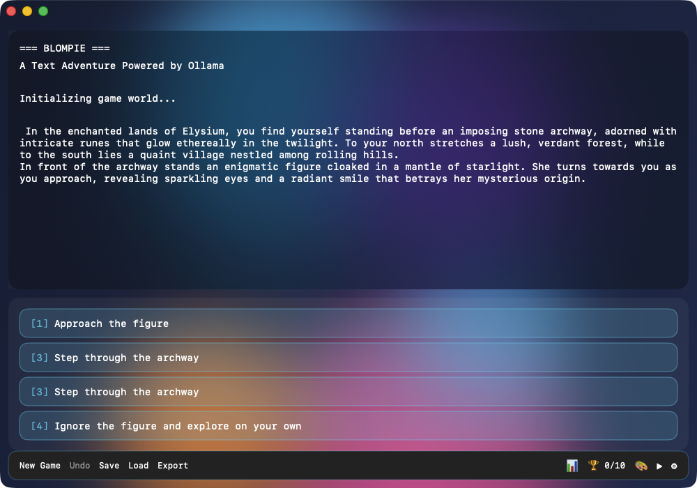
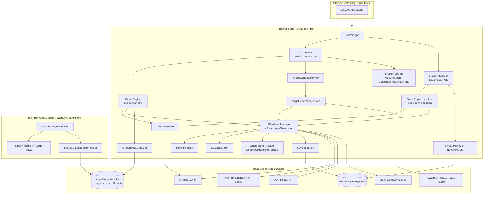
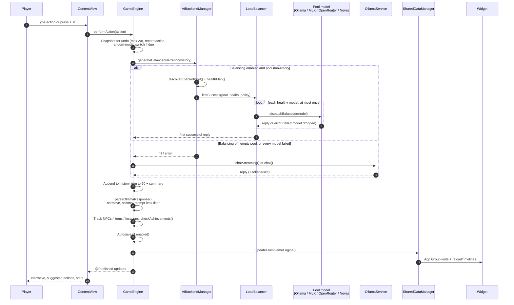
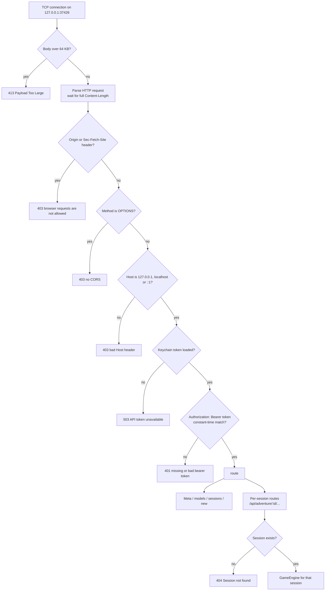

# Blompie


[](LICENSE)

-informational)


**An AI-powered text adventure for macOS. Every playthrough is generated on the fly.**

Blompie is a native SwiftUI text adventure in the spirit of Zork. A local language model acts as the game master: it invents the world, the characters, the items and the consequences of whatever you type. By default everything runs on your own Mac through Ollama. You can optionally spread story generation across every local model you have (Ollama + MLX), frontier models through OpenRouter, and the Nova Gateway, with automatic failover between them.

Blompie also exposes a token-protected loopback HTTP API so AI agents (Nova, Claude Code, scripts) can play adventures programmatically, and ships a WidgetKit widget that shows your current game at a glance.

Written by Jordan Koch ([@kochj23](https://github.com/kochj23)).



---

## Table of Contents

- [Features](#features)
- [Architecture](#architecture)
- [Data Flow](#data-flow)
- [Multi-Model Load Balancer](#multi-model-load-balancer)
- [Nova API (Local HTTP API)](#nova-api-local-http-api)
- [Security](#security)
- [Requirements](#requirements)
- [Installation](#installation)
- [Building from Source](#building-from-source)
- [Testing](#testing)
- [How to Play](#how-to-play)
- [Configuration Reference](#configuration-reference)
- [Repository Notes](#repository-notes)
- [License](#license)

---

## Features

### Gameplay (GameEngine)

| Feature | Details |
|---|---|
| Procedural adventures | A Zork-style game-master system prompt drives the model to create locations, NPCs, items, puzzles and plot turns. Combat is deliberately non-lethal; conflicts are puzzles, negotiations or escapes. |
| Story progression rules | The prompt requires every action to move the story forward (no re-describing the same scene). |
| Free-form input | Type any action in natural language, or click one of the 2-4 suggested actions. |
| Suggested actions | Parsed from the model reply in three accepted formats: `ACTIONS: a \| b \| c`, a numbered list (including `1. **Bold action**`), or a "What do you do?" style header followed by a list. If nothing parses, defaults are offered (Look around, Continue, Go back, Examine surroundings). |
| Prompt-leak filtering | Lines that echo the system prompt are stripped from the narrative before display. |
| World tracking | NPC names, inventory items and visited locations are extracted heuristically from each reply and shown in the sidebar (Locations / Inventory / Characters tabs). |
| Achievements | 10 achievements persisted across sessions: First Steps, Explorer (5 locations), World Traveler (20), Social Butterfly (5 NPCs), Diplomat (15), Collector (5 items), Hoarder (15), Conversationalist (50 actions), Veteran Adventurer (200 actions), Trader (defined, not yet awarded by the engine). |
| Undo | Every action snapshots messages, conversation history and suggested actions. Up to 20 snapshots are retained (oldest dropped first). |
| Recent actions | The last 5 actions are shown under the transcript; the engine keeps the last 10. |
| Bounded context | Conversation history is capped at 50 non-system messages. Older turns are condensed into a single system summary message so long games keep their context without unbounded token growth. |
| Detail level | Brief (1-2 sentences), Normal (2-4) or Detailed (4-6). |
| Tone | Serious, Balanced or Whimsical. |
| Creativity | Temperature slider in Settings. |
| Random model mode | Optionally switch to a random installed Ollama model every 3, 5, 10 or 15 actions; the switch is announced in the transcript. |
| Statistics | Total actions, NPCs met, items, locations, achievements, current model, last tokens/sec, save count, message count. |

### Saving and Export

- Unlimited named save slots (Save dialog), plus an `autosave` slot written after every AI reply when auto-save is enabled.
- Load dialog lists slots newest first with date and message count; individual slots can be deleted, or all saves at once from Settings.
- The autosave is restored automatically on launch; if none exists a new game starts.
- Export the full transcript as a plain-text file via a save panel.
- Game state, saves, settings and achievements are stored in `UserDefaults` (settings as one consolidated JSON bundle, with one-time migration from the older per-key format).

### Interface (ContentView, Design/ModernDesign)

- Glassmorphic UI: animated gradient background with floating blobs, glass cards, monospaced type.
- Live streaming display: tokens appear as Ollama generates them (or instant mode when streaming is off).
- Tokens-per-second readout from Ollama's `eval_count` / `eval_duration`.
- Number keys `1`-`n` trigger the matching suggested action.
- Font size 8-36 pt via slider or `Ctrl+Shift+=` / `Ctrl+Shift+-`.
- Toolbar: New Game, Undo, Save, Load, Export, Stats, Achievements, Image Generation, Sidebar, Settings.
- Five color themes (Classic Green, Amber Terminal, Retro Blue, Paper Mode, Matrix Green). The selection is persisted; Paper Mode switches the window to light appearance.

### AI-Generated Artwork (ImageGenerationService / ImageGenerationView)

- Generate a Scene Illustration, Character Portrait or Item/Object image from the latest narrative, or use a custom prompt.
- Six styles that append style keywords to the prompt: Realistic, Artistic, Fantasy, Pixel Art, Cartoon, Anime.
- Backend priority: SwarmUI (`:7801`, Flux schnell) then Automatic1111 (`:7860`). ComfyUI (`:8188`) is detected but generation through it is not implemented yet and returns a clear error.
- Save the result to the Desktop as PNG or copy it to the clipboard; recent images are kept for the session.

### macOS Widget (Blompie Widget target)

| Size | Shows |
|---|---|
| Small | Adventure name, action count, achievement count |
| Medium | Adventure name, last action, action count, achievement progress |
| Large | Current adventure, achievement progress, AI backend status and model |

- Data is shared through the App Group `group.com.jkoch.blompie` (`SharedDataManager`), written after every AI reply and whenever an achievement unlocks, followed by a `WidgetCenter` timeline reload.
- The timeline also refreshes every 15 minutes. A configuration intent toggles "Show AI Status".

### AI Backends

| Backend | Role | Default endpoint |
|---|---|---|
| Ollama | Default story engine (streaming and non-streaming `/api/chat`) | `http://localhost:11434` |
| MLX | Local Apple Silicon models from the Hugging Face cache, run via `mlx_lm.generate` (balancer only) | in-process CLI |
| OpenRouter | Frontier models, one Keychain-stored key (balancer only) | `https://openrouter.ai/api/v1` |
| Nova Gateway | Optional OpenAI-compatible gateway, inherits Nova's own routing (balancer only) | `http://127.0.0.1:18792` |
| SwarmUI / Automatic1111 / ComfyUI | Image generation (see above) | `:7801` / `:7860` / `:8188` |

`AIBackendManager` also probes TinyLLM, TinyChat and OpenWebUI for availability; those are not used by the story path.

---

## Architecture



### Source map

| Path | Purpose |
|---|---|
| `Blompie/BlompieApp.swift` | App entry point; starts the Nova API server; font-size menu commands |
| `Blompie/GameEngine.swift` | Game state, system prompt, response parsing, world tracking, achievements, undo, save/load, export, settings |
| `Blompie/ContentView.swift` | Main window, sidebar, save/load/settings/stats/achievements sheets |
| `Blompie/OllamaService.swift` | Ollama `/api/tags` and `/api/chat` (streaming + non-streaming), tokens/sec |
| `Blompie/NovaAPIServer.swift` | Loopback HTTP API, Keychain token, request gate |
| `Blompie/ImageGenerationService.swift`, `ImageGenerationView.swift` | Artwork generation |
| `Blompie/ColorTheme.swift` | Theme definitions and `CodableColor` |
| `Blompie/TokenMeterView.swift` | Circular tokens/sec gauge component |
| `Blompie/SharedDataManager.swift` | Writes widget data to the App Group |
| `Blompie/Design/ModernDesign.swift` | Shared palette, glass modifiers, animated background, gauges |
| `Blompie/Services/ModelRegistry.swift` | Model discovery, pool assembly, `LoadBalancer` |
| `Blompie/Services/OpenRouterProvider.swift` | OpenRouter constants, OpenAI-compatible request builder, `FailoverPlanner` |
| `Blompie/Services/KeychainStore.swift` | Generic-password Keychain wrapper |
| `Blompie/Services/LLMBackendType.swift`, `LLMLoadBalancerSupport.swift` | Balancer backend taxonomy, `ChatMessage`, `LLMError` |
| `Blompie/AICapabilities/*` | Shared cross-project capability module (compiled in, no UI entry point in Blompie) |
| `AIBackendManager.swift` | Backend detection, URLs, configuration persistence, balancer toggles |
| `AIBackendManager+Balancer.swift` | Pool discovery, health gating, balanced dispatch per backend |
| `AIBackendManager+Generation.swift` | Single-backend `generate()` for Ollama / TinyLLM / TinyChat / OpenWebUI / MLX |
| `Blompie Widget/*` | Widget provider, views, data model, App Group reader |

---

## Data Flow

### Player action to screen and widget



### Nova API request



---

## Multi-Model Load Balancer

Settings > **Multi-Model Load Balancing** has three independent toggles. With all three off (the default), Blompie uses Ollama only, exactly as before.

| Toggle | Adds to the pool |
|---|---|
| Balance across all local models (Ollama + MLX) | Every model from Ollama `/api/tags`, plus every `*mlx*` repo in `~/.cache/huggingface/hub` |
| Enable all frontier models (OpenRouter) | Every model id from OpenRouter `/models` (falls back to a built-in popular list if the fetch fails). Requires an OpenRouter API key, entered in Settings and stored in the Keychain. |
| Use Nova Gateway (optional) | One entry, `nova`, at `http://127.0.0.1:18792/v1/chat/completions` |

How a request is dispatched:

1. **Pool assembly** (`ModelRegistry.assemblePool`): concatenates the enabled sources and de-duplicates by `backend|model` id, preserving order. Unreachable sources contribute zero models; discovery never throws.
2. **Health gating**: each distinct backend is probed once (Ollama `/api/tags`, MLX binary present, OpenRouter `/models` with the key, Nova `/v1/models`). Models on unhealthy backends are skipped. Nova is never required; a failed health check simply drops it.
3. **Selection policy** (`BalancerPolicy`): `roundRobin` cycles through healthy models; `leastBusy` (the default) picks the model with the fewest in-flight requests, ties broken by pool order.
4. **Failover** (`LoadBalancer.firstSuccess`): tries each healthy model at most once in policy order. A model whose request throws is dropped and the next is tried. Every attempt is checked out and back in, so in-flight counts stay accurate on failure. It returns the first success, returns `nil` when no model is healthy, and rethrows the last error only when every healthy model failed.
5. **Fallback**: if balancing is off, the pool is empty, nothing is healthy, or every model failed, `GameEngine` falls back to the plain Ollama path (streaming or non-streaming according to Settings).

The balanced path is non-streaming (the reply appears when complete); the Ollama fallback streams.

---

## Nova API (Local HTTP API)

`NovaAPIServer` listens on **127.0.0.1:37426** only (never on external interfaces). It lets agents create and drive adventure sessions; each session owns its own `GameEngine`, independent of the window.

### Authentication

Every route, including `/api/ping`, requires:

```
Authorization: Bearer <token>
```

On first launch Blompie generates a random 256-bit token (64 hex characters) with `SecRandomCopyBytes` and stores it in the login Keychain:

- service: `net.digitalnoise.blompie.api`
- account: `api-token`

If the Keychain is unavailable the API stays off. Read the token at call time; never paste it into scripts or files:

```bash
TOKEN=$(security find-generic-password -s net.digitalnoise.blompie.api -a api-token -w)

curl -s -H "Authorization: Bearer $TOKEN" http://127.0.0.1:37426/api/status

SID=$(curl -s -X POST -H "Authorization: Bearer $TOKEN" -H "Content-Type: application/json" \
  -d '{"model":"mistral:latest","tone":"whimsical","detail":"brief"}' \
  http://127.0.0.1:37426/api/adventure/new | python3 -c 'import sys,json;print(json.load(sys.stdin)["sessionId"])')

curl -s -X POST -H "Authorization: Bearer $TOKEN" -H "Content-Type: application/json" \
  -d '{"command":"look around"}' \
  http://127.0.0.1:37426/api/adventure/$SID/action
```

### Request gate (`NovaAPIGate`)

| Check | Result on failure |
|---|---|
| Request larger than 64 KB (65,536 bytes) | 413 |
| Any `Origin` or `Sec-Fetch-Site` header (browser) | 403 |
| `OPTIONS` (CORS preflight) | 403 |
| `Host` not `127.0.0.1`, `localhost` or `::1` (DNS-rebinding defense; port ignored) | 403 |
| No token in Keychain | 503 |
| Missing or wrong bearer token (constant-time comparison) | 401 |
| `command` empty or over 500 characters (action route) | 400 |

Responses never include CORS headers and always carry `X-Content-Type-Options: nosniff`, `Cache-Control: no-store` and `Connection: close`.

### Routes

| Method | Path | Body | Returns |
|---|---|---|---|
| GET | `/api/status` | | status, app, version, port, uptimeSeconds, activeSessions |
| GET | `/api/ping` | | `{"pong":"true"}` |
| GET | `/api/models` | | Installed Ollama models (from `127.0.0.1:11434/api/tags`) and a recommended model |
| GET | `/api/adventure/sessions` | | Array of sessions: sessionId, model, messageCount, inventory, isLoading |
| POST | `/api/adventure/new` | optional `model` (default `qwen2.5:72b`), `tone` (`serious`/`balanced`/`whimsical`), `detail` (`brief`/`normal`/`detailed`) | 201 with sessionId, settings, initialMessages, suggestedActions |
| GET | `/api/adventure/:id` or `/api/adventure/:id/state` | | isLoading, messageCount, last 10 messages, suggestedActions, inventory, locations, npcs, actionCount |
| GET | `/api/adventure/:id/history` | | All messages, actionHistory, inventory, locations, npcs |
| POST | `/api/adventure/:id/action` | `{"command": "..."}` (1-500 chars) | Waits up to 120 s for the reply; returns new messages, suggestedActions, inventory, `timedOut`. 429 if the session is still generating. |
| POST | `/api/adventure/:id/save` | optional `slotName` (default `nova-<first 8 of id>`) | `{"saved":true,"slotName":...}` |
| GET | `/api/adventure/:id/saves` | | Array of save slots: id, name, messageCount, savedDate (ISO 8601) |
| POST | `/api/adventure/:id/undo` | | undone, messageCount, last 5 messages |
| DELETE | `/api/adventure/:id` | | `{"deleted":true,"sessionId":...}` |

Unknown routes return 404; unknown session ids return 404 `Session not found`. Sessions live in memory and are lost when the app quits; saves go to the same store as the app's save slots.

---

## Security

- **Secrets live only in the macOS Keychain.** The Nova API token (`net.digitalnoise.blompie.api` / `api-token`), the OpenRouter key (`KeychainStore`), and any cloud keys handled by `AIBackendManager` (service `com.jordankoch.Blompie`, migrated out of `UserDefaults` on first run) are never written to `UserDefaults`, files or the repository.
- **No secrets in the repo.** Nothing is hardcoded; the `SourceCodeSecurityTests` suite scans the sources for hardcoded keys and passwords.
- **Local API hardened** as described above: loopback bind, bearer token on every route, browser and preflight refusal, Host allow-list against DNS rebinding, constant-time token compare, request and command size limits, no CORS.
- **Local by default.** With the balancer toggles off, all inference stays on your Mac (Ollama on localhost). OpenRouter is used only when you enable it and supply a key; Nova Gateway only when you enable it.
- **No telemetry.** Blompie has no analytics or phone-home code.
- **Entitlements.** Network client access and the `group.com.jkoch.blompie` App Group. The app is not sandboxed (it needs to launch `mlx_lm.generate` and read the Hugging Face cache).

See [SECURITY.md](SECURITY.md) for reporting vulnerabilities.

---

## Requirements

| Requirement | Version |
|---|---|
| macOS | 14.0 (Sonoma) or later |
| Xcode | 15 or later (to build from source) |
| Ollama | Any recent release, running on `localhost:11434`, with at least one model pulled (default `mistral`) |
| Optional | `mlx-lm` (`/opt/homebrew/bin/mlx_lm.generate`) for MLX models; an OpenRouter API key; Nova Gateway on `127.0.0.1:18792`; SwarmUI or Automatic1111 for artwork |

Apple Silicon with 16 GB RAM is recommended for larger local models.

---

## Installation

### From DMG

1. Download `Blompie-v1.1.1-build4.dmg` (current version **1.1.1, build 4**) from [Releases](https://github.com/kochj23/Blompie/releases).
2. Open the DMG and drag **Blompie** to `/Applications`.
3. Start Ollama and pull a model:

```bash
brew install ollama
ollama serve
ollama pull mistral
```

4. Launch Blompie. It restores your autosave, or starts a new adventure.

---

## Building from Source

```bash
git clone git@github.com:kochj23/Blompie.git
cd Blompie

# Release build
xcodebuild -project Blompie.xcodeproj -scheme Blompie -configuration Release build

# Archive
xcodebuild -project Blompie.xcodeproj -scheme Blompie -configuration Release \
  -archivePath build/Blompie.xcarchive archive
```

Or open `Blompie.xcodeproj` in Xcode and press Cmd+R. The scheme builds the app and embeds the widget extension.

---

## Testing

```bash
xcodebuild -project Blompie.xcodeproj -scheme Blompie test
```

The suite contains **271 XCTest cases, all passing**, in 7 categories. Network-dependent logic (pool parsing, balancing, failover, the API gate) is factored into pure functions so it is tested without live backends.

| Category | Classes (test count) | Total | Covers |
|---|---|---|---|
| Security | SourceCodeSecurityTests (8), NovaAPIGateTests (10), InputSanitizationTests (3), EthicalAIGuardianSourceTests (6), ComprehensiveSecurityTests (9) | 36 | No hardcoded secrets, API gate (browser/Host/token/size), input limits, Keychain usage |
| Performance | PerformanceTests (8) | 8 | Gate throughput, constant-time compare independent of mismatch position, Ollama tag and OpenRouter model parsing, pool de-dup scaling, balancer selection; `XCTest measure` blocks with time budgets |
| Retry | RetryTests (9) | 9 | `LoadBalancer.firstSuccess` failover, unhealthy models never attempted, all-fail rethrow, in-flight bookkeeping, round-robin fairness after failover, re-authentication on retry after 429 |
| Unit | ComprehensiveUnitTests (30), AIBackendEnumTests (6), AIErrorTests (6), ImageStyleTests (3), ImageGenerationErrorTests (6), GameModelTests (14), ColorThemeTests (16), OllamaServiceTests (17), LoadBalancerTests (20), WidgetDataTests (9), AIBackendManagerTests (5) | 132 | Models, enums, errors, themes, Ollama Codable contracts and tokens/sec, registry and balancer, widget data |
| Integration | ComprehensiveIntegrationTests (9), NovaAPIServerTests (7) | 16 | Component wiring, API server configuration |
| Functional | ComprehensiveFunctionalTests (14), GameEngineTests (12), ResponseParsingTests (26) | 52 | Engine behavior, settings, undo, achievements, save/load, action parsing |
| Frame | ComprehensiveFrameTests (18) | 18 | Framework scaffolding: singletons and engines initialize with correct defaults (GameEngine, AIBackendManager, SharedDataManager, URLs, achievements) |
| **Total** | 25 classes | **271** | |

Test sources live in `BlompieTests/`.

---

## How to Play

1. Launch Blompie. The game master describes the opening scene and offers actions.
2. Click a suggested action, press its number key, or type your own (`talk to the merchant`, `climb the tower`, `trade the lantern for the map`).
3. Watch the reply stream in. New suggestions appear when it finishes.
4. Use **Undo** to rewind, **Save** / **Load** for named slots, **Export** for a transcript.
5. Open the sidebar for locations, inventory and characters; the trophy button lists achievements; the stats button shows totals.
6. Tune model, streaming, balancing, creativity, detail, tone, auto-save, random model mode and theme in **Settings**.

---

## Configuration Reference

| Setting | Where | Default |
|---|---|---|
| Model | Settings > Model (refreshable list from Ollama) | `mistral` |
| Streaming | Settings | On |
| Balancer toggles | Settings > Multi-Model Load Balancing | All off |
| OpenRouter key | Settings (shown when frontier toggle is on), stored in Keychain | none |
| Balancer policy | `AIBackendManager.balancerPolicy` | `leastBusy` |
| Creativity (temperature) | Settings | 1.3 on first run |
| Detail / Tone | Settings | Normal / Balanced |
| Auto-save | Settings | On |
| Random model mode | Settings, every 3/5/10/15 actions | Off, 5 |
| Theme | Settings > Color Theme | Classic Green |
| Font size | Settings slider or `Ctrl+Shift+=` / `Ctrl+Shift+-` | 14 pt |
| Nova Gateway URL | `UserDefaults` key `AIBackend_NovaGatewayURL` | `http://127.0.0.1:18792` |
| Ollama URL (balancer) | `UserDefaults` key `AIBackend_OllamaURL` | `http://localhost:11434` |

"Reset All Settings to Defaults" in Settings restores the game settings.

---

## Repository Notes

The repository root also contains `EthicalAIGuardian.swift`, `AIBackendManager+Enhanced.swift`, `AIBackendManager+EthicalGuardian.swift` and `AIBackendStatusMenu.swift`. These are legacy files from the shared AI backend module and are **not compiled into any target**; they are not part of the shipped app. (`EthicalAIGuardianSourceTests` only inspects the guardian source file.)

See [CHANGELOG.md](CHANGELOG.md) for release history and [CONTRIBUTING.md](CONTRIBUTING.md) for contribution guidelines.

---

## License

MIT License. Copyright (c) 2024 Jordan Koch. See [LICENSE](LICENSE) for the full text.

---

Written by Jordan Koch ([@kochj23](https://github.com/kochj23)).
